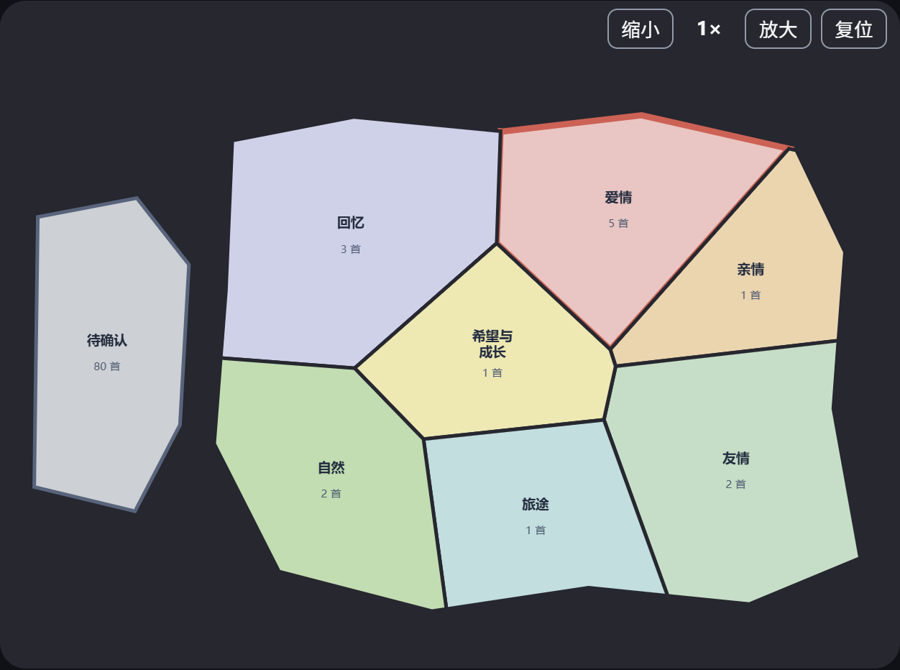

# 曲境使用手册（本地演示版）

曲境目前的主流程只有三步：**找歌 → 审查 → 保存**。第一次使用，建议先用“歌曲主题地图”选一个区块，做一张小歌单；熟悉后再尝试听感相似曲和高级整理。

```text
打开软件 → 选音乐文件夹 → 分析
                         ↓
① 找歌：看地图、试听、筛选 → 选“加入候选”
                         ↓
② 审查：删去不合适的歌、调整顺序
                         ↓
③ 保存：下载播放清单，或预览并复制成文件夹
```

## 1. 打开并分析音乐

1. 双击项目根目录的 **`启动曲境.cmd`**，保持弹出的启动窗口开启。如果浏览器没有自动打开，访问 `http://127.0.0.1:8501/`。
2. 在左侧“**音乐来源文件夹**”输入本地音乐目录，或点“**浏览文件夹**”选择目录。第一次可直接使用预填的“音乐samples”。
3. 点“**分析此文件夹**”。页面出现“已分析曲目”后即可操作。分析只读取原音乐；受保护或无法解码的文件会跳过。以后换音乐目录，重新选目录并再点一次分析。
4. 左侧“**切换为英文**”可以切换界面语言。歌名、歌手、专辑和原始文件路径仍保留其原文。

## 2. 在“① 找歌”发现歌曲

页面默认打开“**听感地图**”。四张地图的用途如下：

| 地图 | 怎么看、怎么选 | 当前边界 |
|---|---|---|
| 听感地图 | 横向约为节奏速度 BPM（越右越快），纵向约为声音明亮度 BRI（越上越亮），蓝→橙表示声音活跃度 ACT。点一个圆点，在右侧看详情并试听；选“框选区域”或“圈选区域”可圈出多首。 | 坐标是趋势，不是精确刻度；精确数值看歌曲详情。默认“基础声学地图”，点“建立模型听感地图”才建立更完整的声音画像。星座只是趣味轮廓。 |
| 歌曲主题地图 | 点“爱情”“亲情”等色块，查看块内歌曲、试听并挑选。块上的数字是歌曲数。 | 无歌词时多依赖明确的标题词；“待确认”不能被当成已识别主题。 |
| 流派地图 | 看人工核实过的专业流派分类。 | 原音乐文件写了某个流派，不等于已经核实；可靠类别不足时会提示无法有效绘图。 |
| 演唱语言地图 | 按可靠歌词识别结果看中文、英文等分布。 | 没有歌词或语言模型时显示未知，不凭歌名猜演唱语言。 |

四张地图都有“**放大／缩小／复位**”。`1×、2×、4×、8×`是查看倍率，**不是歌曲之间的声学距离**。听感图若有圆点重叠，打开“**重叠歌曲**”列表逐首查看；放大不是唯一办法。



*图：当前样本的真实主题地图截图。区块大小和歌曲数会随你选择的音乐文件夹改变。主题块相邻表示大致相关；灰色“待确认”独立放置。*

## 3. 把发现的歌放入候选

**点歌曲或点主题块，先是查看，不会悄悄改变歌单。**单首歌可用右侧“**将当前歌曲列为待加入**”；听感图框选／圈选后，可点“**将选区列为待加入**”。主题块和相似歌曲等操作也会先生成“**这批发现**”。接着明确选择：

| 按钮 | 效果 | 适合什么时候 |
|---|---|---|
| **加入候选** | 把这批新歌加进现有候选，重复音频不重复加入。 | 想把不同地图发现的歌汇到一起。 |
| **仅保留交集** | 现有候选中，只留下也出现在这批发现里的歌；不会加入新歌。 | 已有候选太多，想继续缩小范围。 |
| **新建候选** | 用这批发现替换现有候选。 | 想重新做一张歌单；旧候选会被替换，先确认不再需要。 |

例如，已有候选 A、B、C，这批发现是 B、C、D：三个按钮分别得到 **A、B、C、D**；**B、C**；**B、C、D**。页面“**当前候选**”会显示数量，右侧的“**去审查**”可直接进入下一步。

若需要更细的找歌方法，可在“**不可放宽的条件**”设标签条件，或使用“**按听感找相似／渐变路径／混合歌单**”。结果为零首时先放宽条件，也可点“撤销最近一项条件修改”。“**可选：用一句话提出筛选条件**”需要你自行配置新的大模型密钥、同意发送输入的描述文字；没有密钥不影响手动找歌。

## 4. 在“② 审查”试听和删选

1. 点“**② 审查**”或右侧“**去审查**”，查看当前候选曲目表。
2. 在“**试听候选曲目**”选歌播放；不合适的歌放进“**从结果中移除**”。这是审查排除，不会删除本地音频；从排除栏移走即可恢复。
3. 如需调整顺序，在“**调整歌曲顺序**”选一首，点“**上移／下移**”。确认后点“**去保存**”；若还想继续选歌，点“**继续找歌**”。

## 5. 在“③ 保存”选择输出方式

先填写“**歌单名称**”，再按目标选一种输出：

- **下载播放清单**：获得 `.m3u8` 文件。这只是播放器使用的歌曲路径清单，不复制音频；之后移动原音乐文件，旧清单可能失效。
- **复制为文件夹**：展开此栏，检查“输出位置”和“复制预览”；勾选“我已试听并核对……”后才点“**创建文件夹**”。它复制副本，原音乐保持不动。
- **按标签分成多个文件夹**：展开此栏，选 1—3 个分组标签，先看预计文件夹和复制预览，再确认创建。它只整理**当前候选**，不是自动整理整个曲库。

若要对**全部曲库**逐曲查看档案、按编码定制歌单或一次性分文件夹，打开页面上方“**高级工具：档案与全库整理**”。高级工具与地图共用同一次分析；一般做一张歌单时不用打开它。

## 常见提醒

- **没有歌词**：主题图可用明确的标题线索，但大量歌曲会留在“待确认”；演唱语言不能仅凭标题确定。可以补充音频旁同名 `.lrc`／`.txt` 歌词文件，再在主题页读取本地歌词。
- **没有模型或大模型密钥**：基础地图、人工试听、候选歌单和文件夹导出仍可使用。大模型不是启动曲境的必要条件。
- **网页打不开**：确认“启动曲境”的命令窗口仍开着；浏览器地址应为本机 `http://127.0.0.1:8501/`，不是公网网址。不要同时重复启动多个占用 8501 端口的实例。
- **数据安全**：分析、试听、下载清单不会改写原音频；创建文件夹前一定核对预览和输出位置。本地演示版尚未连接 QQ 音乐私人曲库。
